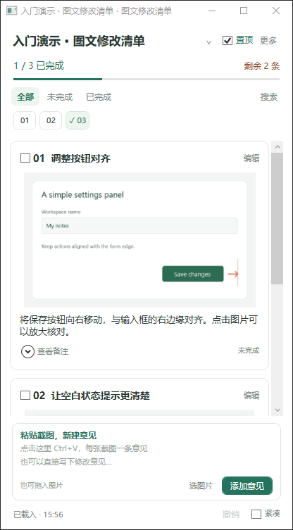

# 图文修改清单 / Picture Checklist

一个 Windows 本地图文修改清单工具。把截图和文字意见收进小浮窗，一边修改，一边核对，完成后直接打钩。

当前版本：**1.0.6**。许可：[MIT](LICENSE)。



## 使用

1. 将 `picture-checklist-1.0.6-windows.zip` 完整解压到可写文件夹。
2. 双击 `PictureChecklist.exe`。
3. 新建清单，选择清单资料的保存位置。
4. 在底部输入区按 **Ctrl+V** 粘贴截图；每张截图自动成为独立意见。
5. 点击标题左侧的完成框标记完成，再次点击可重新打开。

“免安装”表示解压即可运行，仍需要系统具备 **.NET Framework 4.8 或兼容的更新版本**。程序正常运行不需要管理员权限。

支持目标为 Windows 10 1903 及以后版本（x86/x64）和 Windows 11（x64）。开发机已进行桌面实测，其他系统与硬件组合尚未逐一验收，ARM64 不作兼容承诺。详见[兼容性说明](docs/兼容性.md)。

启动前可双击便携包中的 `Check-Environment.cmd` 检查运行环境。源码中的对应脚本是 `scripts/check-environment.ps1`。

## 日常功能

- **连续图文浮窗**：置顶、拖动、调整大小、紧凑显示、编号快速跳转。
- **直接收集意见**：粘贴截图、拖入或选择图片，默认一图一条；也可新增纯文字意见。
- **完成状态直观**：一键打钩、取消完成、进度统计、搜索与筛选。
- **图片查看**：单击图片打开大图，支持适合窗口、100% 与缩放；小图可放大。
- **正文复制**：直接拖选意见正文，按 Ctrl+C 复制；右键可复制或全选。
- **轻量编辑**：修改标题、正文、备注，排序、删除、撤销与回收站。
- **保留多图用途**：历史多图条不自动拆开，需要时可显式拆为单图意见。
- **独立清单资料**：自动保存、完整 ZIP 备份、恢复副本及旧格式迁移。

上方清单名称菜单用于新建、打开、切换与归档；“更多”收纳高级整理、图片资料库、回收站、备份和迁移。

完整操作见[使用说明](docs/使用说明.txt)。仓库的 [examples/getting-started](examples/getting-started) 是三条合成意见组成的入门清单，不包含实际项目资料。建议复制一份后体验。

清单库每行的“删除”可移除本机列表入口，原清单文件、图片和进度保留；删除前会确认，支持“撤销删除”，也可通过“打开清单”重新加入。

## 数据放在哪里

清单保存在你选择的文件夹中，主要包括 `checklist.json`、`assets` 和 `backups`；迁移过的清单另有 `migration`。图片导入后归清单资料夹管理，不依赖临时截图文件。

窗口位置和最近清单等本机设置保存在 `%LOCALAPPDATA%\PictureChecklist`。程序更新与清单资料分别进行；更新时先关闭正在打开同一清单的旧版窗口。

底部“已保存”表示文件已成功写入。保存失败时修改留在窗口中，可重试或另存副本。尚未点击“添加意见”的文字草稿，在正常关闭或切换清单前会提交为文字意见；异常退出不能保证恢复尚未写入的输入。

## 从源码构建

源码包名为 `picture-checklist-1.0.6-source.zip`。代码使用 C# 5、WPF 和 .NET Framework 4.8；构建脚本使用 Windows 中的 Framework 编译器。

在源码根目录执行：

```powershell
powershell -NoProfile -ExecutionPolicy Bypass -File .\scripts\check-environment.ps1
powershell -NoProfile -ExecutionPolicy Bypass -File .\scripts\build.ps1
powershell -NoProfile -ExecutionPolicy Bypass -File .\scripts\run-tests.ps1
powershell -NoProfile -ExecutionPolicy Bypass -File .\scripts\package.ps1
```

脚本会输出构建、测试或打包结果的位置。

## 反馈与贡献

提交问题时请附上程序版本、Windows 版本、系统架构、复现步骤和完整错误文字。截图或样本请先移除私人内容。开发约定见 [CONTRIBUTING.md](CONTRIBUTING.md)，版本变化见 [CHANGELOG.md](CHANGELOG.md)。

代码按 [MIT License](LICENSE) 分发。
